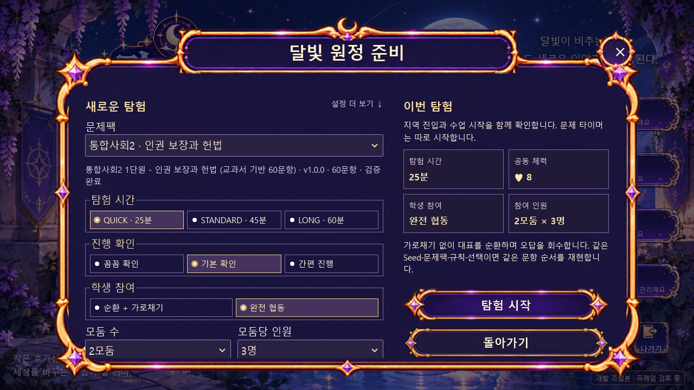
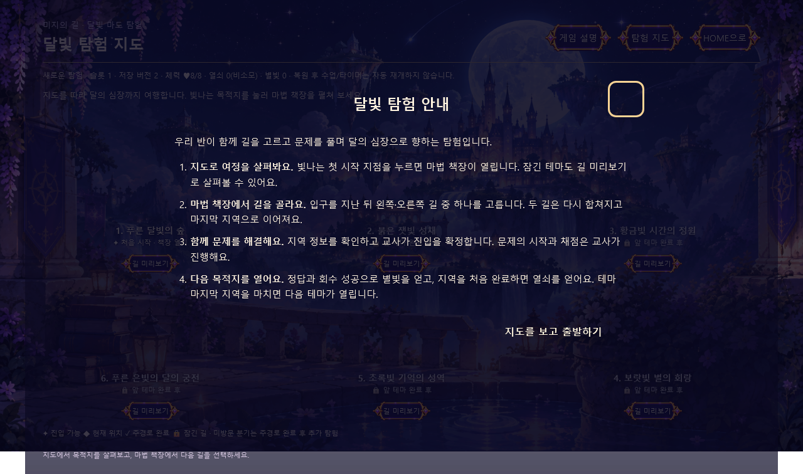
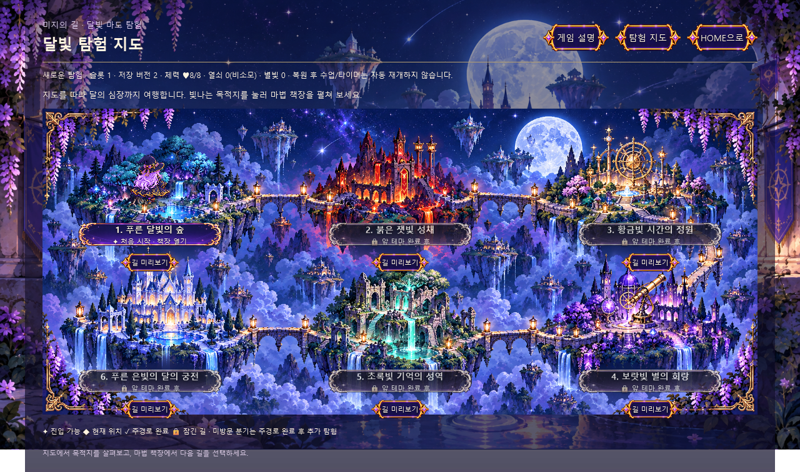
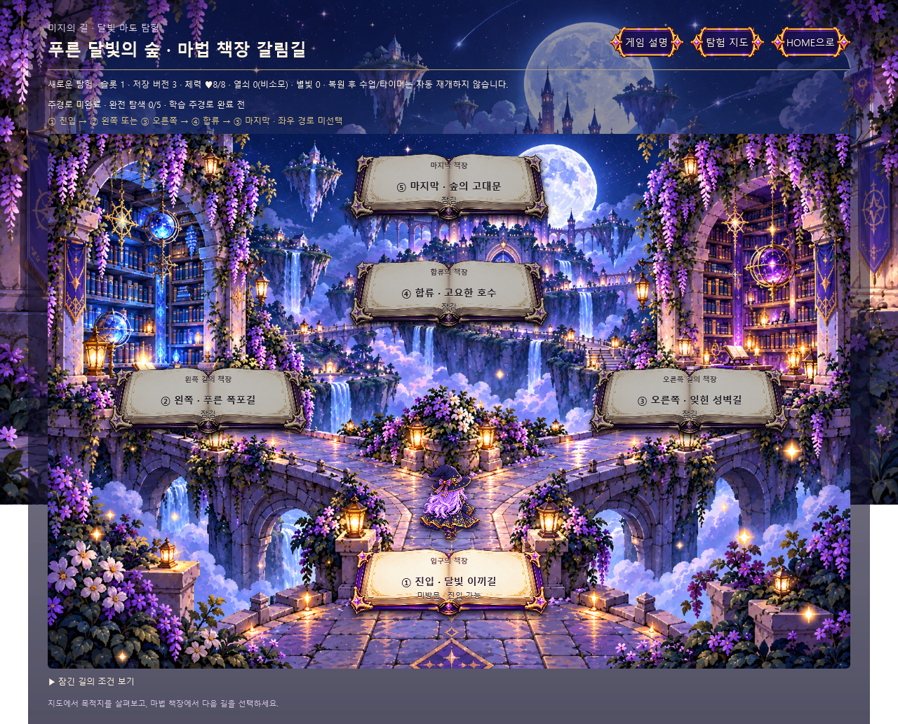
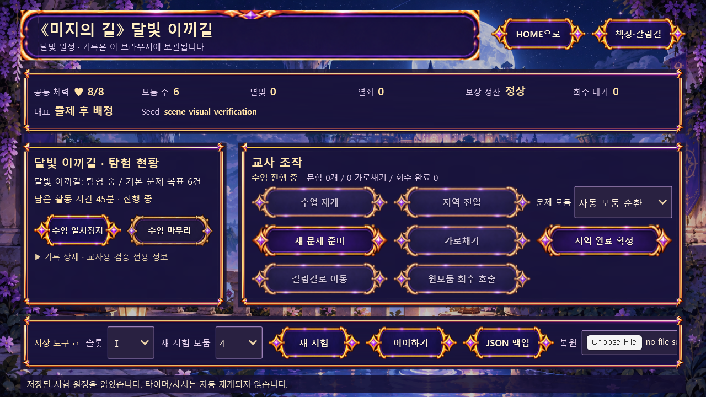
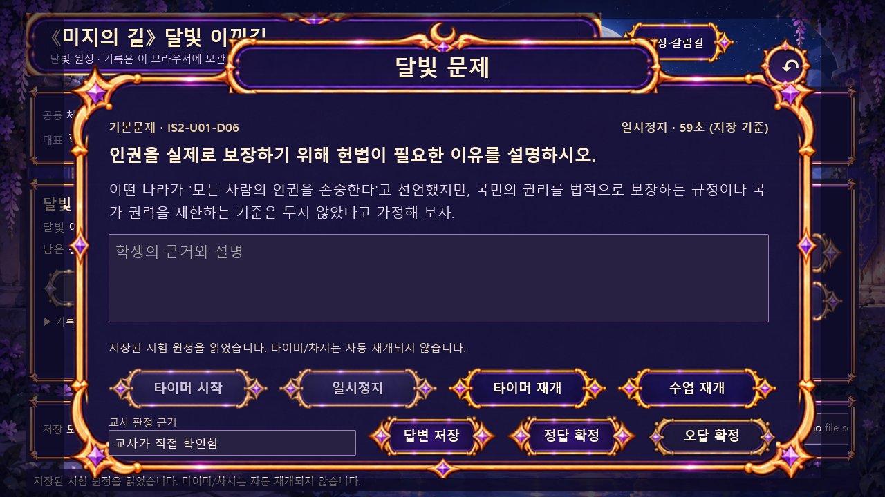
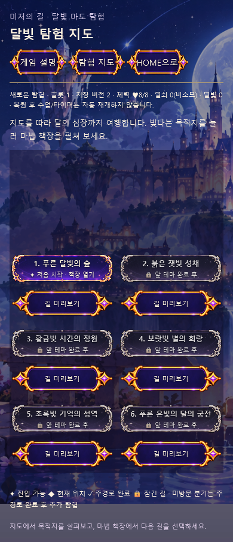
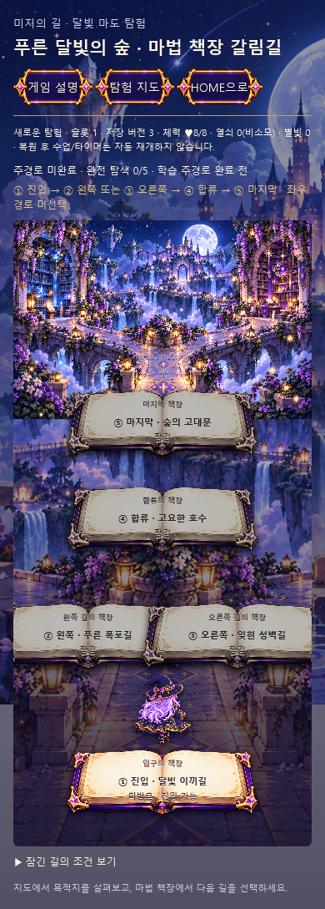

# 《미지의 길 : 달빛 마도 탐험》 v4.1.1 통합 제작 기준서

## 최신 통합 제작 기준 2026년 10월 22일

이 절은 HOME 공통 팝업 개편부터 탐험 준비 규칙, 지역 문제·상태창, 지도·마법 책장 갈림길·마도사 후면 제작까지 반영한 현재 기준이다. 사용자 최신 지시가 아래 과거 원문과 충돌하면 이 절에 명시한 변경 범위를 우선 적용한다. 변경하지 않은 원래 42개 결정과 게임·저장 불변식은 유지한다. 이후의 ‘과거 원문과 당시 검증표’는 이력이며 현재 상태의 미구현 판정으로 읽지 않는다.

### 1 현재 작업 범위와 보존 기준

| 항목 | 현재 기준 |
|---|---|
| 게임 | 《미지의 길 : 달빛 마도 탐험》 v4.1.1 |
| 저장소 | tugoyam119-blip/teacher.yujin |
| 시험 브랜치 | cloudflare-moonpath-v411-test |
| 프로젝트 | classroom-hub/apps/moonpath-v41/ |
| 시험 HOME | https://moonpath-v411-test.kkyj119.workers.dev/home-b/ |
| 지도·갈림길 | journey/?slot=1~3, 선택한 실제 저장 슬롯 사용 |
| 지역 실행 화면 | dist/phase2-9-one-region-smoke.html, 파일명은 개발 이력이며 실제 지역 엔진 연결 |
| 보호 대상 | main·Railway·moonpath-dev 운영 경로·승인 HOME 원본·실사용자 저장 |
| 최종 게임 변경 기준 | 357d0a20278eb4484adf1745a8ee0712179547c2 |
| main 마지막 확인 기준 | f7e0e8e29428b3b7118c9553cd517f870bfd785e |

문서에 기록한 커밋·검사는 해당 작업 시점의 증거다. 다음 개발에서는 최신 HEAD·실제 배포를 다시 확인한다. 이번 정리는 게임 코드나 저장 데이터를 바꾸는 작업이 아니다.

### 2 확정한 화면 순서와 학생의 경로 선택

**HOME → 새로운 탐험 설정 → 게임 기본 설명 팝업 → 전체 탐험 지도 → 처음 시작 지점 클릭 → 마법 책장 형태의 갈림길 → 지역 정보·교사 진입 확인 → 지역 탐색·문제 → 판정·보상·결과 → 다음 길 또는 안전 종료**

학생은 지도에서 앞으로 갈 세계와 연결 다리를 먼저 본다. 지도는 테마 이름을 나열한 메뉴가 아니라 목적지와 여정을 확인하는 화면이다. 열려 있는 목적지를 누르면 해당 테마의 마법 책장 갈림길로 이동한다. 잠긴 테마의 ‘길 미리보기’는 가능하지만 진입은 차단한다. 설명은 ‘게임 설명’에서 다시 볼 수 있으며, 설명 확인 여부는 탭별 sessionStorage에만 기록한다.

6테마 순서는 푸른 달빛의 숲 → 붉은 잿빛 성채 → 황금빛 시간의 정원 → 보랏빛 별의 회랑 → 초록빛 기억의 성역 → 푸른 은빛의 달의 궁전이다. 테마 안에서는 **①입구 → ②왼쪽 또는 ③오른쪽 → ④합류 → ⑤마지막**을 따른다. 처음에는 입구만 열리며 입구를 완료해야 좌우 선택이 열린다. 다음 테마는 앞 테마 마지막 지역 완료 후 해금한다. 미방문 분기는 주경로 완료 후 추가 탐험하고 원위치로 돌아온다.

현재 지도는 섬·다리의 1→6 순서, 책장은 테마 안의 지역 선택으로 표현한다. 과거 ‘좌3/우3 책장에 6테마를 나열’하던 배치는 이 흐름으로 대체한다. 테마 이름·색·30지역·해금·추가 탐험 규칙은 유지한다. 진행 중 문항·가로채기·회수에서는 지도 이동으로 판정을 우회할 수 없다.

이어하기는 저장된 화면·지역·문항·답변·남은 시간으로 복원하며, 기본 설명이나 처음 시작으로 되돌리지 않는다. 수업과 타이머는 자동 재개하지 않는다.

### 3 HOME 공통 팝업 마스터 v2

HOME의 기존 배경·로고·캐릭터·메뉴 배치는 유지한다. 장식·프레임·버튼은 이미지 레이어, 제목·본문·설정·상태·입력·선택·동작은 HTML/CSS/JS 레이어로 분리한다. 일반 웹 모달식 다중 CSS 테두리로 픽셀아트 프레임을 대체하지 않는다.

| 항목 | 실행 규격 |
|---|---|
| 공통 팝업 | 820×500 논리 크기, HOME 기준 위치70,20 |
| 제목 안전 영역 | x204,y36,w412,h32 |
| 제목 장식 | x180,y24,w460,h56 |
| 닫기 | 원본 장식 위치를 보존, desktop 클릭 영역 x756,y16,64×64; 모바일44~48px 이상 |
| 일반 본문 | x48,y116,w724,h252, 본문 스크롤 |
| 일반 footer | x48,y396,w724,h80; 메시지와44px 버튼 분리 |
| 버튼 | 주 동작·보조·취소 3역할 × normal/hover/pressed/disabled 4상태 |
| 작은 화면 | 글자16px·버튼44px 이상, 세로 재배치·문서/본문 스크롤, 읽기 어려운 축소 방지 |

새 탐험 준비는 같은 프레임 안에서 본문을 x48,y116,w724,h360으로 확장한다. 왼쪽424·오른쪽284, 간격16이며 오른쪽 하단 x488,y348,w284,h128에 상태/시작/돌아가기를 둔다. 제목·닫기 안전 영역은 유지한다. 공통 팝업은 native dialog의 키보드 포커스·Escape·호출 버튼 복귀를 사용한다.

프레임·버튼은 현재 대화 STEP03/04에서 시각적으로 채택했고 STEP05 구현을 지시받은 범위다. 전체 게임 출시나 다른 화면 디자인의 일괄 승인이 아니다. [STEP05 상세](HOME_B_POPUP_V2_STEP05_20261022.md)와 [팝업 자산 대장](../data/home-popup-v2-assets.json)을 따른다.

### 4 새로운 탐험 준비와 실제 규칙

왼쪽에서 문제팩·탐험 시간·진행 확인·참여 방식·모둠·인원·Seed를 정하고, 오른쪽에서 실제 설정 요약을 확인해 시작한다. 슬롯·이름·문제별 타이머는 펼침 설정에 둔다. 첨부 구버전의 예상 문항 수나 FINALE 열쇠 소비를 임의 이식하지 않는다.

| 설정 | 현재 동작과 기본값 |
|---|---|
| 활동 시간 | 25/45/60분, 기본45분. 현재 차시의 활동 시간만 집계하고 일시정지를 제외 |
| 시간 도달 | 교사가 ‘이번 문항 후 수업 마무리’를 예약. 현재 문제를 자동 종료·채점하지 않으며 처리 후 종료; 예약 취소 가능 |
| 꼼꼼 확인 | 수업 시작·지역 진입·문제 타이머 시작을 각각 확인 |
| 기본 확인 | 지역 진입에 수업 시작 포함, 타이머는 별도 시작; 기본값 |
| 간편 진행 | 교사의 지역·첫 문제 시작 확인으로 수업·지역·첫 출제·첫 타이머 연결 |
| 순환+가로채기 | 기존 모둠·대표 순환과 가로채기·회수 유지; 기본값 |
| 완전 협동 | 대표 순환·회수 유지, 가로채기는 UI와 엔진 양쪽에서 차단 |
| 명단 | 2~8모둠, 모둠당1~10명. 새 UI 기본6모둠×4명, 실제 초기 명단으로 저장 |
| Seed | 64자 이내, 공란 자동 생성·저장. 같은 팩/버전·규칙·선택 이력과 함께 출제 재현 |
| 문제팩 | 기본60문항 또는 검증한2MiB 이하60문항 YQBank JSON; 원본 팩을 저장·백업에 포함 |
| 문제별 타이머 | 기본60초; 45/60/90/120초 또는 끔. 활동 시간과 별개 |
| 공동 체력 | 새 탐험8, 기본 오답−1, 유효 회수+1(최대8). 소진 후 교사 확인으로 책장 복귀·회복, 기존 진행 보존 |
| 열쇠·별빛 | 지역 최초 완료 열쇠+1·비소모, 최초 유효 정답/가로채기/회수 별빛+1. 복습 재정답+0 |

새 준비 규칙은 settings.preparation.version=1인 새 탐험에 적용한다. 기존 탐험을 자동 변환하지 않으며 구형 엔진 호출의 기본4모둠과 기존 저장은 호환한다. 활동 시간은 저장 명령마다 확정하며, 예기치 않은 종료 뒤 알 수 없는 시간을 추산하지 않는다. 판정·정정·보관·복원 확인은 간편 진행에서도 생략하지 않는다. 이동 인계는 슬롯·탐험ID·정확한revision·5초를 검증하는 일회용 기록이며, 지연되면 안전하게 일시정지로 열고 교사가 재개한다. [준비 규칙](HOME_B_PREPARATION_RULES_20261022.md), [공동 체력](SHARED_HEALTH_RULES_20261021.md).

### 5 지역 문제 팝업과 지역 화면

지역 문제 팝업도 승인된 공통 프레임/명판/닫기/버튼을 사용한다. 820×500에서 제목(204,36,412,32), 콘텐츠(48,108,724,228), footer(48,348,724,128)로 분리한다. footer는 상태24·간격8·타이머44·간격8·채점44다. 기존 문항 ID·입력·제출·교사 판정·가로채기·회수·보상과 타이머 상태를 유지하고, 정지/재개나 다시 그릴 때 답안을 초기화하지 않는다. 기존 숨김 시계 값도 유지한다.

지역 기본 화면은 HOME 배경 원본과 공통 UI 이미지를 사용한다. 960×540에서 명판(28,14,624,68), 이동(668,24,264,44), HUD(28,94,904,88), 본문(28,194,904,224), 저장 도구(28,430,904,72), 메시지(28,510,904,24)다. HUD는 체력·모둠 수·별빛·열쇠·회수·대표·Seed 등 실제 상태값을 표시한다. 본문은 왼쪽 진행/수업 관리, 오른쪽 교사 조작3열이다. 하단 백업·파일 선택·복원·이어하기를 유지한다. 질문 중 HOME·수업 재개 버튼은 팝업 안으로 옮겼다가 닫힐 때 원래 조작 영역으로 복귀시킨다.

표시 모듈은 기존 컨트롤과 이벤트를 재배치하며 엔진·출제·채점·저장 스키마를 변경하지 않는다. 작은 화면은 글자·버튼 크기를 유지해 세로 배치한다. 현재 지역 실행 HTML은 배경/17개 UI 이미지를 포함하는5,554,818바이트이며, 30지역별 새 배경30장을 제작한 것은 아니다. [지역 팝업](REGION_QUESTION_POPUP_V2_20261022.md), [지역 화면](REGION_SCENE_PIXEL_STYLE_20261022.md).

### 6 지도와 책장 및 마도사 픽셀아트

내장 image_gen으로 HOME 배경·장식·캐릭터 원본을 실제 참고해 신규 PNG4장을 제작했다. 원경/부유섬/달빛/폭포/등나무/금색 등불의 밀도와 남색·보라·금색을 맞춘다. 갈림길은 실제 Y자 돌길과 좌우 마법 서고가 연결되고, 그 위에 빈 양피지 책을 독립 선택 레이어로 조립한다. 마도사는 보랏빛 긴 머리, 짙은 모자·망토와 금빛 별 장식의 뒷모습이다.

| 파일 | 규격 | 원본 SHA256 |
|---|---|---|
| assets/journey/pixel-v1/world-map.png | 1916×821 RGB | 1eebe3f8c7131fd9f330415ca5f001876ec47d9aa470dad073ad5701a92295dd |
| assets/journey/pixel-v1/library-crossroads.png | 1536×1024 RGB | e1d6d885407f33aa32e297d9c27b821ae48cda453683117c9a65c36dc6b54d79 |
| assets/journey/pixel-v1/magic-book.png | 2060×763 RGBA | da2dcc115d6ac1c7c11328f5bdd864549293f4512300f2e5959e385a592f8684 |
| assets/journey/pixel-v1/mage-back.png | 1182×1330 RGBA | 96d048a69e795f921451343c8b1a07ec5d5fd707e49b9b8bbb795935549d0044 |

생성 원본은 바이트 그대로 별도 경로에 복사했으며 크롭·리사이즈·색/알파 변경은 없다. 실제 파일 해상도와 브라우저 표시 크기는 구분한다. 전체 프롬프트4개·바이트·알파·출처는 [신규 이미지 대장](../data/journey-pixel-v1-assets.json)에 보존한다. GitHub 원본 재다운로드와 실제 시험 사이트 파일4개 전체의 해시가 일치했다. 신규4종의 최종 사용자 시각 승인은 아직 별도이며, 이번 문서 정리 요청을 일괄 디자인 승인으로 해석하지 않는다.

마도사는 저장된 현재 테마/지역 또는 최초 진입 가능 위치에 표시한다. 자유 이동·걷기 애니메이션을 구현한 것은 아니다. 텍스트·잠금·진행·클릭 영역은 HTML이며 그림에 인쇄하지 않는다. PC 지도/갈림길은 최대1200px 반응형·비율 유지·문서 스크롤, 모바일 지도는 전체 지형 미리보기+선택2열, 책장 갈림길은 세로 재배치다. 이는 기존960×540 고정 contain에서 달라진 지도/갈림길 개발 UI 예외이며, 나머지 화면의 논리 좌표를 일괄 바꾸지 않는다. [픽셀아트 적용 기록](JOURNEY_PIXEL_ART_20261022.md).

### 7 저장과 복원 및 원본 보존

공식 저장은 IndexedDB 상태·이벤트·최신/직전 정상 체크포인트를 단일 트랜잭션으로 확정한다. 슬롯ⅠⅡⅢ는 독립이며 기존 스키마·저장 키를 유지한다. 문항/답안/타이머/대표 순환/보상/회수/Seed/팩/명단/이벤트 이력을 복원한다. 복원 후 자동 수업·타이머 재개는 금지한다.

보관은 원래 슬롯·팩·이력을 보관함에 저장하고 안전하게 슬롯을 비우는 동작이다. 복원은 원래 슬롯이 비어 있을 때만 가능하고 점유 슬롯 덮어쓰기·손상 파일은 거부한다. 실제 JSON 다운로드와 복원 후 이어하기를 검증했다. 새로고침 직후 쓰기 임대가 남으면 강제 탈취하지 않고 최대30초 후 명시적으로 다시 연다.

이번 시각 개편 검사는 사용자 프로필과 분리한 임시 WebKit 문맥·합성 저장에서 수행했다. 실제 사용자 DB를 초기화하거나 시험 데이터를 덮어쓰지 않았다. HOME 원본·기존60문항·main·Railway는 보존했다. 새 준비 기능을 추가했던 단계와, 이후 엔진을 변경하지 않은 시각 개편 단계를 구분한다.

### 8 구현과 검증 및 배포 이력

| 단계 | 결과와 근거 |
|---|---|
| STEP01~02 | HOME/버튼/기존 큰 팝업 원본 조사,3안 비교와820×500·안전 영역 설계 |
| STEP03~04 | 공통 프레임v02와 버튼3역할×4상태 제작·채택, 원본/파생 구분 |
| STEP05 | 공통 HOME 팝업 연결, 당시 자동562개 및 실제 PC/모바일 팝업 조작 |
| 준비 화면 후속 | 실제 새 규칙·한 화면 설정/요약, 자동570개·팝업15개·교사 확인3모드 |
| STEP07~08 | Cloudflare 시험 자동 배포 확인, 실제 새 탐험→문제→이어하기→백업→보관→복원12개 |
| 지역 문제 |7문항 유형·입력·타이머·교사 판정과 가로채기/회수8개, 저장복원12개 |
| 지역 전체 화면 | HUD/교사 버튼/저장 도구/PC·모바일8개, 원래 엔진·저장 보존 |
| 설명→지도→책장 | 지형 선택과 지역 진입·정보 미리보기·취소의 무변경 확인 |
| 최신 픽셀아트 | 자동572개, 실제 지도/책장/마도사/해시/저장 보존7개, 로컬 교사 확인3모드, 실제 저장복원12개 PASS |

수치는 각 기록의 검사 범위를 말하며 서로 합산한 전체 검수 건수가 아니다. 최신 연속12개에는 실제 답안 제출/교사 정답 확정, 두 번째 문항 중단, 남은 시간 이어하기, 명시 재개, JSON 백업, 점유 슬롯/손상 파일 거부, 정상 보관/복원, 복원 후 이어하기와 별도 기존형 시험 슬롯 보존이 포함된다.

게임 구현 주요 커밋은 공통 팝업88c0544, 준비 규칙15a6b01, 지역 문제c596a46, 지역 화면7b12345, 지도 흐름ed6133d, 최신 픽셀아트357d0a2다. 최신 게임 배포 빌드는 a4cc6f7c-e601-4b09-91b4-afdefec25d98 success, 배포6c305b7c-a6d6-4a45-9d6e-16183b8d90cc, 버전56b87dac-0ebf-4999-bf5a-be02d219dcd6 100%였다. 이후 문서 커밋은 게임 변경과 구분한다. 시험 브랜치 push가 기존 Git 연결을 통해 자동 배포되므로 수동 배포를 중복 실행하지 않는다.

느린 기존 지역 HTML 로딩에서 첫 ACTIVE 기대/30초 탐색 제한으로 중단된 검사2회가 있었다. 게임의5초 인계/안전 일시정지 규칙은 바꾸지 않고, 명시 교사 재개를 허용하는 검사와 더 긴 탐색 대기로 전체12개를 확인했다. 실패 시도를 PASS로 바꾸지 않는다. Node 재다운로드의 인증서 오류는 인증서 검증을 끄지 않은 WebKit 전체 다운로드로 대체했다. [STEP07](HOME_B_POPUP_V2_STEP07_CLOUDFLARE_20261022.md), [STEP08](HOME_B_POPUP_V2_STEP08_FINAL_QA_20261022.md), [최신 증거](evidence/20261022-journey-pixel/).

### 9 제작 이미지와 실제 적용 화면

다음 이미지는 링크만 나열한 것이 아니라 기준서 안에 직접 표시한 것이다. 적용 화면은 실제 사용자 데이터가 없는 격리 시험 브라우저 캡처다. 신규 그림 원본과 실행 화면을 구분한다.

#### 공통 팝업 프레임과 버튼

| 역할 | 기본 | 마우스 올림 | 누름 | 비활성 |
|---|---|---|---|---|
| 주 동작 |  |  |  |  |
| 보조 |  |  |  |  |
| 취소 |  |  |  |  |

#### 신규 지도 원본

#### 신규 책장 갈림길 원본

#### 선택용 마법 책과 마도사 뒷모습

#### 보존한 HOME과 현재 탐험 준비

#### 기본 설명과 지도 적용

#### 마법 책장 갈림길 적용

#### 지역 상태창과 문제 팝업 적용

#### 작은 화면 적용

### 10 남은 승인과 제작 및 실검증

| 영역 | 남은 작업 |
|---|---|
| 신규 시각 승인 | 지도·서고·책·마도사4종과 조립 화면에 대한 사용자 최종 시각 승인 |
| 캐릭터 | 현재 후면 정지1장. IDLE/WALK/CAST/SUCCESS/THINK 전체 애니메이션·각 장면 자세는 미완료 |
| 지역별 표현 | 현재 지역 공통 HOME 배경. 30지역별 고유 배경·핵심/추가 탐색 사건·단서·연출은 별도 제작 |
| 전체 플레이 | 6테마 전체 완주·미방문 추가 탐험 전 과정·기본/확장 엔딩 실브라우저 검수 |
| 교실 운영 | 교사 PIN·학생 읽기 전용 창·다중 창·명단 가져오기·고위험 설정·강제 종료/저장 장애 현장 검증 |
| 출력 | PDF/차시 종료 요약·오프라인 한글·CSV/JSON 전체 운영 검증 |
| 오프라인 | 자체 자산 포함 단일 HTML과 file:// IndexedDB·다중 창·입출력·온라인 동등성 |
| 기기 | Windows Chrome/Edge·실제 모바일/가상 키보드·프로젝터/해상도별 조작 |
| 출시 | 운영 main 병합·Railway 운영 배포·최종 게임 출시 승인은 별도 |

V01~V22 전체를 일괄 PASS 처리하지 않는다. 신규4PNG 업로드/표시의 실제 성공은 기록하되 30지역 전체 아트·전체 게임 완료로 확대하지 않는다. 기존 승인 PNG는 보존하고, 앞으로의 생성·파생·전송은 F5 규칙 및 실제 로컬 원본을 확보한 검증된 Git 경로를 따른다. 사용자 지시 없는 Railway/F5 재배포·원본 덮어쓰기·승인 상태 변경을 하지 않는다.

### 11 다음 작업자의 확인 순서

이 통합 절 → CURRENT_IMPLEMENTATION_AND_CHANGELOG_20261021.md → 해당 단계 상세 문서 → 자산 대장 → 최신 브랜치/배포 상태를 확인한다. 시각 변경은 장식과 기능 레이어를 분리하고 원본·해시·현재 상태를 기록한다. 실제 사용자 슬롯으로 시험하지 않는다. 검증에는 브라우저/환경/범위/초기 실패/수정/배포 커밋을 남기며 이전 수치를 새로 실행한 검사로 쓰지 않는다.

---

## 과거 원문과 당시 검증표

아래는 기존 제작 기준과 당시 상태를 보존한 원문이다. 현재 화면 흐름·팝업 크기·준비 규칙·픽셀아트·배포 및 검증 현황은 위 최신 통합 절을 우선 적용한다.

> **2026-10-21 구현 현황 갱신:** [구현·방법·수정 통합 기록](CURRENT_IMPLEMENTATION_AND_CHANGELOG_20261021.md)을 함께 읽는다. HOME B 및 책장·갈림길의 개발 구현과 실제 배포 검증이 추가됐다. 아래 원문과 단계별 당시 기록의 미구현·미실시 표기는 해당 시점의 이력이다. 최종 승인과 미검증 항목은 통합 기록에서 구분한다.

> **2026-10-20 자료 처리 규칙 갱신:** 게임 제작·이미지 작업에 [F5 자료 처리 공식 규칙](F5_ASSET_PROCESSING_RULES_20261020.md)을 기본 적용한다. 별도 F5 재지시 없이 원본 접근→영구 큐→전체 해시 검증→테스트 연결 절차를 수행한다. 승인·게임 브라우저 QA·운영 배포는 별도 게이트다. 아래 2026-10-14 본문 및 V01~V22는 당시 기준 이력이며 일괄 PASS로 승격하지 않는다.

작성일: 2026-10-14 | 상태: 결정 01~42 확정, 실제 구현·원본 대조·테스트 별도 | 범위: **게임 전체 전면 재제작**

## 0. 최우선 적용·충돌 해결

- 이 문서는 v4.0 전면 재제작 기준서를 대체한다. 설정 장식만 다루던 v3.0은 사용 금지.
- 사용자가 나중에 명시적으로 고른 안이 그 앞의 제안보다 우선한다. 변경된 범위 외 기존 결정은 유지.
- **29 B: 모든 게임 그래픽 자산 신규 제작.** 기존 승인 그림은 세계관·외형·색상·구도 참고 자료이며 직접 복사/재사용할 최종 자산이 아니다. 구버전 원본은 보존.
- **17 B: 전체 배경+중앙 문제 팝업** 고정. 이전 하단 확장 패널 C안 폐기.
- **11 B: 전체 60문항 공통 무작위·미출제 우선**. 테마별 고정 문항은행 C안 폐기.
- **32 A: 지역·테마 완료에 별빛 보너스 없음**. 지역 최초 완료 열쇠+1, 최초 정답·유효한 회수 성공에 공동 별빛+1; 복습 재정답 +0.
- **42 C: 공통 게임 엔진에서 온라인·오프라인 두 빌드**. 오프라인 단일 HTML 목표와 IndexedDB/두 창 동기화는 실제 `file://` 브라우저 검증을 완료해야 출시 가능.
- 원본 60문항을 추측으로 다시 쓰지 말 것. 기존 운영 `main`, Railway, 저장 데이터 덮어쓰기 금지. 전체 신규 브랜치/신규 경로에서 작업. 사용자 최종 승인 전 운영 배포 금지.
- 문서 설계 확정과 코드 작성·파일 업로드·PR 병합·Railway SUCCESS·실제 브라우저 검증은 각기 다른 상태.

## 1. 42개 결정 확정 레지스트리

| 번호 | 확정 내용 및 구현 의무 |
|---|---|
| 01 | A 교사 주도형. 교사 PC+프로젝터, 학생 개인 로그인 필요 없음, 오프라인 기본. |
| 02 | C 차시별 완결+장기 탐험. 차시 요약과 슬롯 누적 이어하기. |
| 03 | C 테마 순차 해금+테마 안 갈림길 분기. |
| 04 | C 선택한 주 경로 완료 후 미방문 분기 자유 탐험. |
| 05 | C 지역 기본 문제 수=모둠 수, 교사 조절; 기본 문제 모두 처리 시 지역 완료; 오답 별도 회수. |
| 06 | C 탐험 열쇠(지역 최초 완료+1, 해금 증표·비소모)+공동 마법 별빛(최초 정답/유효 회수+1). |
| 07 | C 회수미션은 다음 지역 이후 자연 등장+교사가 진행/보류/강제 호출. 원래 오답 모둠 우선, 실패·포기 시 타모둠, 중복 보상 방지. |
| 08 | C 공동 별빛+모둠별 누적 공헌도. 정답·회수·유효 가로채기 성공 시 기여 모둠+1; 별빛 소비해도 공헌도 불변. |
| 09 | C 상황별 마법 5종, 단계별 해금, 사용은 교사 확정. 달빛의 속삭임 T1 힌트 비용2, 별의 나침반 T1 경로 정보 비용3, 기억의 수정 T2 회수 단서 비용3, 시간의 모래 T3 +20초 비용4, 숨겨진 별의 눈 T4 추가 탐색 비용5. 문제당 학습 힌트/시간 연장 제한, 정답·열쇠 구매 금지. |
| 10 | C 대표 자동 순환+유연 타이머(기본60초, 45/60/90/120/끔), 교사 정지/재개/추가시간. 원 모둠 오답·포기 시 가로채기 문제당 최대 1, 연속 가로채기 제한, 원모둠 회수 유지. |
| 11 | B 전체 60문항 문제은행 무작위, 미출제 우선, 난이도/유형 균형, 미회수 일반 재출제 금지, 중복 정답 보상 없음. |
| 12 | C 전체 상태 자동 저장+안전 복구, 슬롯 I/II/III, 질문/남은 시간/순환/모든 활동 보존, 저장 실패 성공 표시 금지, JSON 백업·복원, 구버전 키 분리. |
| 13 | C 학생용 지역 결과 카드+교사용 상세 탐험 일지. 차시·누적 통계, PDF/CSV, 변경 감사 이력, 학생 공개 순위 기본 미표시. |
| 14 | C 6테마×5지역=30, ①진입→②좌 또는 ③우→④합류→⑤최종; 각 테마 지형·사건·연출 차별화. |
| 15 | C 자연·유적·별빛 연결 세계; 아래 확정 테마·30지역 명칭과 6개 책장 색상 적용. |
| 16 | C 책장/갈림길/지역은 독립 장면, 지역에서는 탐색→문제→결과 반자동. 새 문제 자동 준비·교사 시작, 정답 되돌리기 차단, 모든 핵심 전환 저장. |
| 17 | B 배경 전체+중앙 문제 팝업. 960×540, 긴 문항 확대·잘림 방지, 학생용 공개 정보와 교사 조작 분리. |
| 18 | C 일반 조작 신속·중요 변경 확인/감사. 정답/보상/강제 해금/삭제 보호, 저장 성공 후 완료 표시. |
| 19 | C 교사 4~8자리 PIN+안전 학생 공개, 5분 미사용 재잠금. 복제 화면 정답 노출 경고, 확장 시 분리. 오프라인 PIN은 강력한 보안 아님. |
| 20 | C 새 탐험 기본 설정+접이식 고급. 3슬롯, 이름, 기본4모둠(2~8), 명단 선택, 기본 모둠 수만큼 문제, 기본60초, 가로채기 켬, 위험 변경 안전 확인/적용 시점. |
| 21 | C 고품질 정적 배경+핵심 순간 선택적 애니메이션. IDLE/WALK/CAST/SUCCESS/THINK, 연출 건너뛰기·모션 감소. |
| 22 | C 보랏빛 장발 치비 마도사=주인공+상황별 안내. HOME 전면, 책장·갈림길 뒷모습, 지역 작은 스프라이트, 결과 성공 동작, 자유이동 조작 없음. |
| 23 | C 이야기 분기+단서·탐색 사건 차별화. 지역 핵심 사건1, 추가 최대2, 좌우 경로 선택·합류 대사 다름. 문제/보상 형평, 양쪽 완료=완전 탐색. |
| 24 | C 단서 자동 수집+선택적 조합, 핵심/추가/경로/조합/세계 기록; 실패 페널티 없음, 일지 재열람, 마법 연동, 중복 획득 방지. |
| 25 | C 여섯 테마 주 경로 완료→기본 엔딩. 6테마 숨겨진 기록 조합→확장 엔딩. 학습 성취 별도, 이후 자유 탐험·엔딩 재감상. |
| 26 | C 안전 저장 후 결과 화면 선택/즉시 종료. 정지→저장 성공 확인→요약 또는 HOME, 재개는 교사 수동. 차시 이벤트 중복 집계 방지. |
| 27 | C 교사 목표+진행속도 추천. 운영 기본45분, 목표 지역/문제/회수, 시간 부족 안내, 강제 종료·문제 자동 삭제 없음. |
| 28 | C 핵심 기능 엔진→1지역 완주 시제품→화면별 시안 승인→구현 비교→통합 검증→최종 승인 후 배포. |
| 29 | B **전체 이미지 자산 신규 제작**. 과거 자산은 참고/보존, 신규 승인 원본 레지스트리, 실제 이미지 업로드·해시·브라우저 표시 확인. |
| 30 | C 42결정 정합성 대조, 최신 명시 결정 우선, 미확정 승인 관리, 운영 버전 보호, 완료 근거 보존. |
| 31 | C 60문항 소진 뒤 복습 순환. 미출제 우선, 그 뒤 기존 정답 문제 재출제, 미회수는 회수 전용, 재정답 기본 별빛0, 같은 지역 중복 최소. |
| 32 | A 기존 별빛 공급만 유지. 차시당 약10문제는 **운영 예상**이지 하드 제한 아님. 지역/테마 추가 별빛0. |
| 33 | C 주 경로 유지+미방문 지역 추가 탐험. 책장→추가 지역→원위치 복귀, 현재 문제 중 이동 금지, 순환/출제 이력 유지. 잠김/미방문/진행/완료/완전 달성 표시; 완전 탐색은 테마별 5지역 완료. |
| 34 | C 원본 활동 로그 보존+연쇄 재계산. 판정 정정 시 파생 가로채기·회수·별빛·공헌도 재검증, 학생 실활동 기록은 감사에 유지, 별빛 부족 시 정산 필요·소비 차단, 일관된 트랜잭션. |
| 35 | C 문항 통합 스키마+유형 확장: questionId/type/stem/choices/answer/explanation/conceptTags/difficulty/source/revision. 객관·진위·단답·서술, 교사 판정, 원본/실제 출제 스냅샷 분리. |
| 36 | C 모둠 고유 ID·구성 버전 유지, 결석/지각/조퇴/이동 안전 처리, 문제 종료 후 변경, 대표/공헌/원오답 회수 주체 이력 불변, 실제 해결자 별도 기록. |
| 37 | C 단일 공식 타이머+직렬 이벤트. PREP/RUN/PAUSE/EXPIRE/RESOLVE, 시각·seq, 시간의 모래 별빛 차감+연장 원자적, 만료는 교사 확인, 복구 후 정지. |
| 38 | C 차시 경과시간(정지 중에도 흐름)+실제 활동시간(정지 제외) 구분, 문제/지역/회수 별도 집계. 0~2표본 예측불가, 3~4 참고, 5+ 중앙값, 종료 강제 금지. |
| 39 | C 환경 선택 단일·이중 창. 복제/확장/단일 수동 선택, 확장 학생 창 공개 정보 읽기 전용, 교사 공식 창 단독 변경, 통신 중단 시 안전 대기, 오프라인 호환 시험. |
| 40 | C IndexedDB 공식 상태+이벤트 이력+최신·직전 정상 체크포인트, 상태·이벤트 트랜잭션, revision/쓰기 소유권, JSON 파일 백업·복원, 이전 데이터와 분리. |
| 41 | C 960×540 마스터, 캐릭터64×64(필요하면128), 작은 아이콘24/32, 중앙 팝업 최대820×440. L0~L6 분리, IDLE4/WALK6/CAST6/SUCCESS4/THINK3, 30지역 개별 지형·광원·환경. |
| 42 | C 공통 엔진→온라인(클래스룸/Railway) 및 오프라인(내장 단일 HTML) 이중 빌드, 동일 규칙·버전, IndexedDB·두 창·PDF/CSV/JSON 무인터넷 실증, PR/승인/실배포 확인. |

## 2. 확정된 6테마와 30지역

| 테마/책장색 | ① 진입 | ② 왼쪽 | ③ 오른쪽 | ④ 합류 | ⑤ 최종 |
|---|---|---|---|---|---|
| 푸른 달빛의 숲 / 짙은 파랑·청록 | 달빛 이끼길 | 푸른 폭포길 | 잊힌 성벽길 | 고요한 호수 | 숲의 고대문 |
| 붉은 잿빛 성채 / 진홍·구리 | 붉은 낙엽길 | 불꽃 제련소 | 무너진 감시탑 | 재의 광장 | 봉인된 성채 |
| 황금빛 시간의 정원 / 황금·호박 | 햇살의 계단 | 황금 시계탑 | 바람의 회랑 | 시간의 정원 | 태양의 제단 |
| 보랏빛 별의 회랑 / 보라·남색 | 별가루 산책로 | 부유섬 다리 | 밤의 관측소 | 성운의 광장 | 별의 대회랑 |
| 초록빛 기억의 성역 / 에메랄드·연두 | 이끼 낀 문 | 속삭이는 정원 | 잊힌 기록실 | 생명의 샘 | 기억의 성역 |
| 푸른 은빛의 달의 궁전 / 푸른 은빛·백색 | 은빛 수정길 | 얼어붙은 서고 | 달빛 거울정원 | 별의 왕좌 앞 | 달의 심장 |

왼쪽 책장 파랑·빨강·노랑 / 오른쪽 보라·초록·푸른 은빛. 주 경로①→② 또는③→④→⑤, 테마 완료 후 다음 테마 해금. 미방문 분기는 별도 추가 탐험. 모든 5지역 완료=테마 완전 탐색, 해당 지역 미회수0=학습 완전 달성, 양쪽 경로 단서 조합=숨겨진 기록. 서로 다른 성취축을 섞지 않는다.

## 3. 필수 화면과 상태 전이

HOME → 새 탐험/슬롯(ⅠⅡⅢ)/기본+고급 설정 또는 이어하기 → 마법 책장 → 갈림길 → 지역 탐색(핵심 사건·추가 최대2) → 중앙 문제 팝업(교사 시작, 대표 순환, 타이머, 선택지/서술) → 판정·가로채기 → 별빛/회수 목록 → 다음 문제 또는 지역 완료 카드 → 다음 지역/책장/안전 종료. 교사용 상세 일지·관리자·설정 별도.

논리 상태는 **화면(screen)**, **문제 시도(attempt)**, **차시(session)** 세 축을 분리한다. 단순 화면 이동으로 보상을 다시 지급하거나 정답 선택을 초기화하면 안 된다. 문제는 준비 후 교사가 타이머 시작. 시간 만료는 자동 오답 아님. 진행 중 일반 뒤로가기/추가 탐험 이동으로 판정을 우회할 수 없다.

보상 이벤트 예: 최초 유효 정답/유효 가로채기 +1별빛·실제 성공모둠 공헌+1, 유효 회수 성공+1별빛·실제 해결모둠 공헌+1, 지역 최초 완료 +1열쇠·별빛0. 동일 ID 재실행/재출제 중복 보상 금지. 회수 원래 모둠과 실제 해결 모둠을 별도로 저장.

## 4. 기술 구현 명세

**문항**: 문제팩 v1.0의 실제 60문항 원문·선택지·정답·해설·유형을 원본에서 조회하고 문항 ID/수정 버전/개념/난도/출처 검증. 출제 때 버전·정답 스냅샷 저장. 60문항 소진 이후 기존 정답 문항 복습, 미회수 오답 일반 출제 제외. 부족 시 교사 예외 확인. 실문항 확보 전 가상의 60문항이 완성됐다고 주장 금지.

**이벤트 처리**: 교사 명령→상태/권한/중복ID 검사→새 상태와 보상·회수 장부 계산→**IndexedDB 단일 트랜잭션 확정**→성공 후 UI와 공개 화면 반영. 실패 시 성공 문구 금지. 정정은 원본 로그를 바꾸지 않고 보정 이벤트 추가+파생 활동/보상/통계 재계산. 정산 필요 상태에서는 추가 별빛 소비 금지.

**저장 데이터 필수 영역**: meta(schemaVersion, engineVersion, expeditionId, slot, revision), settings, world(30지역, 주경로, 추가 탐험 복귀), sessions(경과/활동시간·목표), questions(원본ID·팩버전·출제/복습), attempts(답변·교사확정·타이머), teams(ID·명단버전·순환·공헌), recovery(원오답·실제 해결·시도), rewards(열쇠·별빛·사용/정정 장부), magic(5종 사용), clues(단서/조합), eventLog, audit, checkpoints(최신/직전 정상본). 3개 슬롯은 독립. JSON 백업에는 데이터/버전/무결성 포함. 과거 저장 영역과 키 불공유.

**타이머**: 시도별 PREPARED→RUNNING↔PAUSED→EXPIRED_AWAITING_TEACHER 또는 RESOLVED. 접수시각/순번을 기준으로 제출·정지·연장·만료를 직렬 확정. 연장(20초)과 비용(별빛4)은 한 이벤트. 마법 중복 클릭 방지, 재개 시 공식 잔여 시간 사용·자동 실행 금지. 차시 전체 경과와 활성 시간은 별도로 집계, 종료 강제 없음.

**교사/학생 창**: PIN 4~8자리·5분 비활동 잠금. 디스플레이 유형 복제/확장/단일 교사가 선택. 학생 창은 공개 상태의 읽기 전용 투영, 정답/관리자/미발견 단서 데이터 전달 금지. 교사 창 하나만 상태 쓰기; revision 검사·연결중단 대기. 물리적 화면 복제에서 정답 비밀 보장 불가하므로 교사에게 투사 중지 확인 안내.

**레이어**: L0 원경, L1 지형·길, L2 마도사, L3 달빛·마법 효과, L4 UI, L5 중앙 문제/결과 팝업, L6 관리자 안전/확인. 정적 비주얼은 **신규 픽셀아트 PNG**; 글자·버튼·문제·상태는 HTML/CSS/JS. 캐릭터 64×64, IDLE4/WALK6/CAST6/SUCCESS4/THINK3 프레임; 손·지팡이·옷·접지점 일관성. 화면 논리960×540, contain 확대 축소.

**패키지**: 공통 개발 소스 분리관리→온라인 빌드 및 자체 자산 포함 오프라인 단일 HTML 빌드. 인터넷 없을 때 외부 CDN/원격 폰트·서비스 호출 불가. `file://`에서 IndexedDB, BroadcastChannel/다중창, PDF 한글, JSON 파일 입출력의 브라우저별 동작 **검증 필요**. 온라인/오프라인 저장은 자동 공유되지 않고 JSON 파일로 이관. 동일 엔진/문항/자산 버전 사용.

## 5. 제작 과정과 검증 게이트

| 단계 | 작업 | 완료 증거 |
|---|---|---|
| PHASE 0 | GitHub 현재 main, 기존 HOME/expedition 코드·문제팩 60문항·참고 아트/라우팅 확인. 새 전면 개발 브랜치 생성 | 실파일/원문 목록, 문제팩 60개 비교표, 원본 확인 여부 |
| PHASE 1 | 신규 경로의 상태 머신·IndexedDB+체크포인트·슬롯·백업 | 새 탐험/저장/중단/복원 실제 테스트 |
| PHASE 2 | 실제 1지역 완주 시제품: 모둠·문제·가로채기·회수·별빛·열쇠·결과 | 완주 로그, 실패 케이스, 원자성 증거 |
| PHASE 3 | **신규** HOME 시안부터 화면/캐릭터/장식 제작, 자산 1개씩 실제 업로드·해시 검증·화면 반영 | 디자인 승인 + 구현 화면 비교 + 클릭/기능 QA |
| PHASE 4 | 6테마 30지역, 단서·마법·엔딩, 결과/일지, 교사 이중창 통합 | 전 경로·선택 분기 검증 |
| PHASE 5 | 1920×1080,1600×900,1366×768,430×900 / 오프라인 무인터넷 / 브라우저 종료·정정·타이머 1초·두 창 충돌 / PDF·CSV·JSON | 실제 테스트 결과와 미통과 이슈 목록 |
| PHASE 6 | 최종 승인→PR 병합→Railway SUCCESS→실제 운영 URL 접속 및 플레이 재확인 | 커밋/PR/배포/실사용 검증 각각 별도 증거 |

첫 자산 업로드는 소형 시험 성공으로 판단하지 말고 **실제 신규 PNG 원본 전체 SHA 일치 + 브라우저 표시**까지 증명할 것. 로컬 파일↔GitHub 데이터 전달 실패 시 오류와 대안 명시, 임의 다른 자산으로 대체 금지.

## 6. 남은 현장 실증·원본 확인 항목 (미확정이라고 구분)

1. **60문항 실제 파일 원문·정답·해설** 및 문항 유형 비율은 이 문서에 포함되지 않았음. 원본 직접 확보·검증 전 문항팩 확정 금지.
2. `file://` IndexedDB의 저장 영역 안정성·두 창의 동기화 지원은 브라우저별로 제한 가능. 결정 40과 42가 모두 충족되는지 실제 시험 후, 충돌이 드러나면 변경 옵션을 승인받을 것.
3. PDF 오프라인 한글 글꼴/외부 라이브러리, 화면별 정확한 좌표, 30지역 개별 아트는 제작·검증 전임.
4. 장기 반복 출제로 별빛이 모두 소진되면 마법 사용 불가하지만, **게임 진행은 막히지 않는다**(결정32의 의도). 차시당 약10문제는 운영 예상치.
5. 정답 정정 후 가로채기·회수 보상 무효화 및 이미 소비한 별빛 정산은 설계 확정, 실제 장부 회귀 테스트가 필수.
6. 기존 일부 문서의 '승인 원본 반드시 재사용'은 결정29 B로 대체. 기존 이미지의 얼굴·의상·서사 정체성은 신규 제작의 참고 기준이며 원본을 덮거나 삭제하지 않는다.

## 7. 프로젝트 위치와 인수인계

- GitHub: `tugoyam119-blip/teacher.yujin`.
- 구운영 소스: `classroom-hub/apps/moonpath-dev/index.html`, `expedition.html`, `assets/` — **변경 금지**.
- 구 임시 장식 브랜치: `moonpath/setup-decoration-rebuild-20261014` — 전체 재제작용이 아니므로 기반으로 사용하지 않음.
- **신규 작업 위치 제안**: `classroom-hub/apps/moonpath-v41/` (현재 실제 존재 여부는 재조회 필요). 새 별도 브랜치에서 구현.
- Railway 기존 서비스 ID: `a9c17706-3e29-43b3-a7f8-9cd42347737e`; project ID: `8c9fe8b8-166f-4a92-a6c8-a6ca29bb3bb0`. 실제 배포 상황은 다음 대화에서 조회.
- 기존 HOME 참고: `미지의길_HOME_제작기준_v2.0_5차검토(1).md`, `MP_OFFICIAL_PRODUCTION_STANDARD_v1.5_20261010.md`, 승인 시안/문제팩 v1.0. 자료를 찾지 못하면 읽었다고 주장하지 않는다.

### 다음 대화 첫 지시(복사 사용)

> 첨부한 《미지의 길》 v4.1 최종 마스터 제작기준서(결정 01~42)를 기준으로 게임 **전체를 새로 제작**해 주세요. 이전 게임의 코드·그래픽은 비교/참고용이며 운영 `main`과 기존 저장소를 보호합니다. 결정 29에 따라 그래픽은 전부 새로 만들고, 17 B 중앙 문제 팝업·11 B 전체 60문항 무작위·32 A 별빛 공급 유지·40 C 안전 저장·42 C 이중 빌드를 지키세요. 먼저 PHASE 0에서 GitHub 실제 소스와 60문항 원본을 확인하고 신규 전면개발 브랜치·경로를 마련한 뒤, PHASE 1 상태 머신/IndexedDB와 PHASE 2 한 지역 완주형 시제품을 시작해 주세요. 시안·구현 화면은 따로 보여 주고 승인받으며 운영 배포는 최종 승인 전까지 하지 마세요. 수행한 검사만 완료로 보고하세요.

---
**결론:** 42개 설계 선택의 충돌은 명시적 최신 선택으로 정리됨. 아직 **실제 문항 원본 확인·코드 구현·오프라인 브라우저 검증·배포**는 완료되지 않았다.

## 8. 미구현·미검증 의무 추적표 (v4.1.1 추가)

**중요:** 01~42번은 설계 확정이지 구현·검증 완료가 아니다. 다음 항목은 이 문서 작성 시점 기준 실증 자료가 없으므로 전부 **미검증**이다. 실제 증거를 확보한 항목만 상태 변경한다.

| ID | 대상 | 통과 기준 | 작성 시점 상태 |
|---|---|---|---|
| V01 | 60문항 실제 원문·정답·해설 대조 | 60개 고유 ID, 원본과 전문/정답 비교, 누락 내용 명시 | 미구현 또는 미검증 |
| V02 | 통합 문항 엔진 | 객관·진위·단답·서술형 각각 판정, 모호한 답변 교사 확인 | 미구현 또는 미검증 |
| V03 | 출제·복습·회수 분리 | 미출제 우선, 60문항 소진 시 순환, 미회수 오답 분리, 중복 보상 0 | 미구현 또는 미검증 |
| V04 | 세계·분기·추가 탐험 | 6테마·30지역, 주 경로→추가 탐험→원위치 복귀, 해금 검증 | 미구현 또는 미검증 |
| V05 | 탐색 사건·단서·엔딩 | 핵심/선택 사건, 단서 조합, 기본/확장 엔딩 조건 각각 확인 | 미구현 또는 미검증 |
| V06 | 모둠 변경·대표 순환·가로채기 | 2~8모둠, 결석·재편성 이력 보존, 문제당 가로채기 최대 1회 | 미구현 또는 미검증 |
| V07 | 열쇠·별빛·마법 5종 | 최초 정답·회수 +1별빛, 지역 최초 완료 +1열쇠, 사용·해금·중복 검증 | 미구현 또는 미검증 |
| V08 | 정답 정정 연쇄 재계산 | 가로채기·회수·공헌도·소비된 별빛의 정산 필요 상태까지 재검산 | 미구현 또는 미검증 |
| V09 | 타이머 이벤트 경계 | 만료 1초 전 제출·일시정지·마법, 중복 클릭·저장 후 복구 | 미구현 또는 미검증 |
| V10 | 차시 경과·활동시간 | 휴식·종료·재개·PC시각 변화 시 중복 계산 없고 표본 부족 예측 불가 | 미구현 또는 미검증 |
| V11 | IndexedDB 트랜잭션 | 상태+이벤트 원자적 저장, 저장 거부·용량 초과 때 성공 메시지 금지 | 미구현 또는 미검증 |
| V12 | 3슬롯·체크포인트·JSON | 슬롯 독립, 체크포인트 2세대, 파일 무결성·버전 확인 후 복원 | 미구현 또는 미검증 |
| V13 | 교사 PIN·비공개 정책 | 5분 잠금, 정답·해설·PIN·감사 기록 학생 화면 노출 방지 | 미구현 또는 미검증 |
| V14 | 두 창·단독 쓰기 | 확장 모드 읽기 전용 학생 창, 창 종료·중복 교사 창·재동기화 처리 | 미구현 또는 미검증 |
| V15 | 오프라인 file:// 호환성 | Chrome/Edge 무인터넷 환경에서 IndexedDB·두 창 실제 시험 | 미구현 또는 미검증 |
| V16 | 온라인·오프라인 동등성 | 동일 엔진·문항·그래픽 빌드, 네트워크 없이 오프라인 1지역 완주 | 미구현 또는 미검증 |
| V17 | PDF·CSV·JSON 출력 | 무인터넷 생성, 한글 깨짐 없음, 수업 통계 일치, 글꼴/라이브러리 적법성 | 미구현 또는 미검증 |
| V18 | 신규 그래픽 자산·시안 승인 | HOME·설정·책장·갈림길·30지역·캐릭터 동작·팝업 실제 제작 및 개별 승인 | 미구현 또는 미검증 |
| V19 | 신규 PNG 전체 업로드 | 원본 1개 전체 GitHub 저장, 원본과 해시/바이트 일치, 브라우저 표시 | 미구현 또는 미검증 |
| V20 | 해상도·조작·접근성 | 960×540 contain, 1920/1600/1366/430 화면 잘림·겹침 검증 | 미구현 또는 미검증 |
| V21 | 완전한 플레이 시나리오 | 한 지역→테마→전체 기본 엔딩→확장 엔딩까지 저장·회수·분기 통과 | 미구현 또는 미검증 |
| V22 | GitHub·Railway 실제 배포 | 최종 승인→PR 병합→Railway SUCCESS→운영 URL 재접속·저장 확인 | 미구현 또는 미검증 |

### 8.1 검증 상태와 증거 규격

- 상태: `미착수 → 구현 중 → 구현 완료(정적 확인) → 실제 테스트 PASS / FAIL / BLOCKED → 사용자 승인`. 테스트 계획만 작성한 경우 PASS 금지.
- 기록 필수: 테스트 ID, 실행일, OS·브라우저 버전, 온라인 또는 `file://`, 빌드/커밋 SHA, 준비 데이터, 조작 순서, 예상 결과, 관측 결과, 로그·스크린샷·백업파일, FAIL 후 조치.
- GitHub 업로드 성공, PR 생성·병합, Railway SUCCESS, 운영 URL 기능 성공은 각각 별도 검사로 기록한다.
- **소형 PNG의 전송 성공을 신규 원본 전체 이미지 업로드 성공으로 간주하지 않는다.** GitHub의 원본 바이트 일치와 실제 브라우저 표시까지 확인한다.

### 8.2 게임·저장 필수 불변식

1. 기존 `moonpath-dev` 운영 코드, 기존 저장 키 및 데이터는 변경·초기화하지 않는다. 신규 경로·신규 저장소 분리.
2. 지역 기본 문제를 모두 처리하면 완료하며 최초 완료 열쇠 +1, **지역·테마 완료 별빛 +0**. 최초 기본 정답 및 회수 성공 별빛 +1, 재출제 정답 기본 보상 +0.
3. 문제 `attemptId`, 이벤트 `eventId`, 회수 대상 ID 별 고유 기록으로 멱등 처리. 버튼 연타·새로고침·두 창 충돌에서도 중복 지급 0.
4. 정답 판정 정정은 실제 답변·감사 이력을 삭제하지 않고 유효 보상·회수·가로채기·공헌도·통계를 재계산한다. 음수 잔액 대신 정산 필요 상태 사용.
5. 타이머는 복원 직후 자동 시작하지 않는다. 교사 재개 승인 후만 진행한다. 일시정지·차시 경과시간·활동시간은 각각 분리한다.
6. IndexedDB 저장 실패 시 성공·보상 확정 연출 금지, 현재 메모리 데이터 보호 및 JSON 내보내기 안내. 정상 체크포인트 임의 덮어쓰기 금지.
7. 학생용 화면·창 동기화 메시지에 정답·해설·PIN·관리자 감사 정보 제공 금지. 오프라인 파일 소유자의 내부 분석에 대한 완벽한 보안은 보장하지 않는다.
8. 미방문 분기 추가 탐험에서 주 경로 진행 중 상태·순환 이력·문제 이력을 보존하고 복귀한다.
9. **그래픽 전부 신규 제작**하되 기존 그림체와 캐릭터 정체성을 참고한다. 기존 파일 삭제·덮어쓰기 금지.

### 8.3 단계별 개발 완료·배포 차단 규칙

| 단계 | 반드시 확인할 증거 | 미통과 처리 |
|---|---|---|
| PHASE 0 | V01 원본 60문항 검증표·기존 자료 조사·신규 경로 확인 | 문제팩 확정 불가 |
| PHASE 1 | V09·V11·V12 실제 타이머/저장/복구 실험 | 저장 엔진 완료 선언 금지 |
| PHASE 2 | V02·V03·V06~V08 및 V21 중 1지역 완주 | 게임 플레이 가능 선언 금지 |
| PHASE 3 | V18~V20 시안 승인·새 PNG 원본 전송·화면 크기별 검증 | 그래픽 통합 승인 금지 |
| PHASE 4 | V04·V05·V10·V13·V14 전 경로 및 예외 검증 | 전체 게임 완성 선언 금지 |
| PHASE 5 | V01~V21 모두 필수 PASS, 특히 V15~V17 실제 오프라인 시험 | 최종 승인 요청/운영 배포 금지 |
| PHASE 6 | 사용자 최종 승인·PR·Railway·운영 URL 순차 증거 V22 | 성공했다고 보고 금지 |

### 8.4 실패 시 변경 통제

- `file://`에서 IndexedDB/두 창 동기화가 지원되지 않으면 미지원 사실과 환경을 보고하고, 오프라인 로컬 서버·단일 창 전환·설치형 패키지 등 대안은 **사용자에게 별도 승인**받는다. 단일 HTML 요구사항을 몰래 변경하지 않는다.
- 문제 원본에 실제 없는 해설·난이도·채점 기준을 임의로 만들어 채우지 않는다. 미확보 필드 목록을 남긴다.
- PDF가 실패하면 CSV 성공만으로 전체 출력 기능 PASS 금지. 한글 폰트·라이브러리는 적법한 배포 권한을 확인한다.
- 42개 규칙과 실측 조건이 충돌하면 해당 결정 번호, 영향, 대안, 재검증 범위를 보여주고 승인 전에는 조용히 바꾸지 않는다.

### 8.5 다음 대화에서 즉시 시작할 체크리스트

**PHASE 0 수행 순서:** (1) GitHub 기존 소스와 실제 60문항팩 원본 읽기 → (2) 전면 신규 그래픽 참고 기준 목록 → (3) 독립 작업 경로·브랜치 충돌 확인 → (4) V01~V22 실증 추적표 생성 → (5) PHASE 1 착수 가능·차단 항목 명시. **위 항목의 PASS를 확인하지 않고 제작 완료라고 말하지 않는다.**

## 9. 자료 전송·등록·게임 연결 규칙 (2026-10-20 추가)

적용일: 2026-10-20 (KST) · 사용자 확정: 검증 경로 ①을 제작 표준으로 사용하고 ③ 영구 큐를 결합.
이 문서는 자료 접근·전송·검증·게임 연결의 기준이다. 게임 설계 결정 01~42, 디자인 승인, V01~V22를 임의 변경하지 않는다.

## 1. 앞으로의 기본 동작
- 사용자가 게임 개발 또는 이미지 제작·수정을 지시하면, 그 작업에 필요한 원본 확보·F5 접수·원격 검증·테스트 브랜치 연결을 기본 실행 절차에 포함한다. 매번 “F5”를 다시 말하도록 요구하지 않는다.
- 사용자가 시안만 요청하거나 검토·승인을 기다리는 단계라면 그 범위만 수행한다. 테스트 업로드는 디자인 승인이나 운영 반영 승인이 아니다.
- 지원되는 원본 접근 경로와 안전한 전송 경로를 먼저 사용한다. 사용자 수동 다운로드·재업로드를 기본 해결책으로 제시하지 않는다.
- 원본 ID·경로·서명 URL·권한·자동 실행 이벤트가 존재한다고 가정하지 않는다. 원본 접근이 실제 실패하면 막힌 단계와 관측 오류를 보고한다.
- 승인·참고 원본은 보존한다. 수정·정규화·크롭·리사이즈 결과는 새 파생 파일과 새 해시로 기록한다. 본 규칙은 구 그래픽을 신규 게임 최종 자산으로 재사용하도록 허용하는 규칙이 아니다.
- 로고·슬로건 통합 PNG 등 기존 명시 승인 예외는 그대로 유지한다. 그 외 동적 글자·버튼·상태는 HTML/CSS/JS로 분리한다.

## 2. 자료 형식별 처리 범위
| 자료 | 처리 방식 | 완료 조건 |
|---|---|---|
| PNG 원본·파생 PNG | F5 영구 큐 우선 | 원본·Railway·GitHub 전체 바이트 크기/SHA-256 일치 |
| HTML/CSS/JS/JSON/문서 | 인증된 GitHub 텍스트 도구 또는 검증된 git 경로 | 실제 파일 내용·대상 브랜치·커밋 확인, 필요한 코드 검사 |
| ZIP·폰트·영상·기타 바이너리 | 해당 형식을 지원하는 별도 경로 확인 | 원본 크기·해시·재다운로드 대조; PNG 큐로 위장 금지 |
| 원본 미확보 자료 | 지원되는 파일 참조·보관 자료 탐색 | 확보 전 대체 이미지·일부 바이트·경로 문자열을 원본으로 처리 금지 |

서버 PNG 상한은 현재 코드상 25MiB이다. 실전 검증은 20,979,389바이트 PNG와 1/5/10MiB PNG에 한정한다. 상한까지 전부 시험했다고 하지 않는다.

## 3. 고정된 기본 경로
ChatGPT가 접근 가능한 PNG 원본 → 지원되는 파일 참조/다운로드 참조 → Railway 영구 큐 → 서버 내부 인증 → PNG 전체 업로드 및 SHA 대조 → GitHub 테스트 브랜치 → 전체 재다운로드 검증 → PR → 별도 게임 연결·브라우저 검증.

기본 인프라:
- GitHub 저장소: tugoyam119-blip/teacher.yujin.
- F5 테스트 브랜치: test/f5-work-ref-20261020. 기존 test/f5-large-roundtrip-20261020은 과거 시험 이력.
- F5 쓰기 허용 경로: tools/png-transport-lab/ 아래 PNG만.
- Railway 프로젝트 png-binary-upload-f5-lab: 36c746ae-eff3-46a1-ae58-296a004b7410.
- test 환경: 3a2ec2f1-4768-42b0-811a-70e03053e5b9.
- png-f5-receiver 서비스: 4f772e37-0165-4a49-a45b-3178693f8227.
- HTTPS: https://png-f5-receiver-test.up.railway.app.
- 영구 볼륨 500MB, /data, SQLite WAL. 서비스는 단일 실행자 기준.
- 구현·시험: [F5 PR #45](https://github.com/tugoyam119-blip/teacher.yujin/pull/45). PR 생성은 확인했으며 병합하지 않았다.
- [실행 코드·증거](https://github.com/tugoyam119-blip/teacher.yujin/tree/test/f5-work-ref-20261020/tools/png-transport-lab/work-ref-20261020/queue).

## 4. 실행 순서
1. 현재 게임 개발 브랜치 HEAD, 마스터 기준서, 최신 디자인 승인, 자산 장부를 확인한다.
2. 생성·수정 작업은 사용자 지시와 승인 범위에 따라 수행한다. 원본은 그대로 보존한다.
3. 실제 PNG 전체 바이트를 읽고 SHA-256·바이트 크기·픽셀 크기·알파·필요한 앵커를 기록한다. 투명 배경·좌표·종횡비 규칙을 지킨다.
4. 지원되는 다운로드 참조와 {download_url,bytes,sha256,branch,path} 작업 명세를 준비한다. 서명 URL과 토큰을 채팅·문서·GitHub·일반 로그에 기록하지 않는다.
5. 현재 ChatGPT OAuth 도구에서는 UPLOAD_TOKEN/GITHUB_TOKEN 값이 비공개다. 토큰을 사용자에게 요구하거나 재발급하지 않고 서버 내부 값으로 처리한다.
6. 현재 검증된 ChatGPT 접수 방식은 F5_QUEUE_JOB에 단일 작업 또는 배열을 설정한 뒤 test 서비스 재배포다. 작업 API가 구현되어 있다는 이유로 ChatGPT에서 무재배포 인증 호출이 연결됐다고 말하지 않는다.
7. 서버가 원본 다운로드 → 크기·SHA·PNG 구조 검증 → commit=false 수신 검증 → 원격 동일 파일 확인 → 필요한 경우 커밋 → GitHub 콘텐츠 API 전체 다운로드 검증을 실행한다.
8. jobId·state·attempts·원격 크기·SHA·커밋을 확인한다. Work에서 GitHub 파일 전체를 다시 받아 원본과 독립 비교한다.
9. 작업 접수용 환경변수를 비우고 시험용 오류 주입 코드·설정을 제거한다. 최종 배포 SUCCESS, HTTPS 상태, 재시작 후 DB 기록을 확인한다. DB·검증 원본 캐시는 임의 삭제하지 않는다.
10. 테스트 PR을 갱신하거나 초안 PR을 생성한다. 운영 main 병합·운영 게임 배포는 별도 사용자 승인 범위 없이 실행하지 않는다.
11. 아래 게임 연결 게이트를 별도로 수행한다. 전송 성공만으로 자산·화면·게임 완성이라고 보고하지 않는다.

## 5. 영구 큐·중복·재시도 규칙
- 중복 키: branch + path + SHA-256. 동일 요청은 동일 작업을 반환한다.
- 정상 상태: queued → downloading → verified → committing → succeeded.
- 일시 오류는 retry_wait에서 지수 지연 후 자동 재시도한다. 정상 오류 처리 경로는 총 최대 3회 시도다.
- SHA·크기·PNG 불일치 등 입력 무결성 오류는 failed. 같은 손상 입력을 무한 재시도하지 않는다.
- 원본 URL 권한·만료 문제는 needs_source. 새 참조를 실제 발급받아 같은 명세로 다시 접수한다. 서버가 ChatGPT 참조를 스스로 갱신하는 기능은 없다.
- failed/needs_source 작업의 명시적 재접수는 시도 횟수를 초기화한다.
- 검증 원본 캐시를 재사용할 때도 크기·SHA를 검사한다.
- 재시작 후 downloading/verified/committing은 queued로 복구한다. 커밋 전 원격 SHA를 비교하여 이미 일치하면 commit_skipped=true로 완료한다.
- 인증된 상태 API는 source URL을 응답하지 않는다. GET /api/jobs, GET /api/jobs/{id}, POST /api/jobs에는 기존 Bearer 인증이 필요하다.
- 다중 복제본·여러 서비스가 같은 파일을 동시에 수정하는 상황은 검증하지 않았다. 단일 큐 범위를 넘어선 동시 커밋을 안전하다고 단정하지 않는다.

## 6. 실제 게임 연결 게이트
- 전송 경로 tools/png-transport-lab/와 게임 자산 경로 classroom-hub/apps/moonpath-v41/는 다르다. F5 수신기 허용 목록을 몰래 넓히지 않는다.
- 게임에 연결할 때는 신규 개발 브랜치에서 검증 PNG를 테스트 경로에 함께 가져오거나, 지원되는 바이너리 복사 경로를 먼저 검증해 게임용 신규 자산 경로에 별도 배치한다.
- 다른 브랜치 파일은 같은 상대 경로 문자열만 적는다고 포함되지 않는다. 게임 빌드 브랜치에 실제 바이트가 존재하는지 확인한다.
- 임시 서명 URL을 런타임 자산 경로로 사용하지 않는다. 온라인·오프라인 이중 빌드에 같은 승인 자산을 포함한다. 원격 URL만 연결한 것을 오프라인 자산 포함으로 처리하지 않는다.
- 자산 장부 필수 항목: assetId, 역할, 승인 상태, source file ID/출처(비밀 URL 제외), 원본/파생 관계, 크기·해시·규격, F5 jobId, 전송 브랜치·경로·커밋, 게임 연결 경로·커밋, 브라우저 시험 증거.
- 상태는 SOURCE_READ_PASS / QUEUE_SUCCEEDED / REMOTE_BYTES_VERIFIED / GAME_PATH_LINKED / HTML_RENDER_PASS / USER_APPROVED를 각각 기록한다.
- V19는 실제 신규 게임 PNG 전체 바이트 + 게임 경로 + 브라우저 표시까지 충족해야 PASS다. 20MB 시험 PNG 통과로 V18/V19 전체를 PASS 처리하지 않는다.
- 기존 960×540 contain·레이어 분리·알파·좌표·앵커·클릭 영역·문자 선명도·해상도별 겹침·오프라인 검증 의무를 유지한다.

## 7. 실패 시 처리와 보안
- 직접 파일 참조 실패 → 지원되는 파일 접근/원본 보관 자료 확인 → 인증 다운로드 참조 → 원격 실행기 순서로 실제 가능한 경로를 확인한다.
- 로컬 셸 DNS 실패를 모든 환경의 네트워크 불가로 일반화하지 않는다. 이번에는 Node 경로가 성공했다. TLS 인증서 검증을 끄지 않는다.
- GitHub 커밋 직후 raw 호스트 404를 “커밋 실패”로 단정하지 않는다. 실제로 초기 시험에서 추가 커밋이 발생했다. 최종 큐는 인증된 GitHub 콘텐츠 API 전체 바이트 검증과 원격 동일성 확인을 사용한다.
- 실패 단계·HTTP 상태·오류 코드·작업 상태·후속 조치만 기록한다. PNG 일부, 축약 Base64, 가짜 빈 파일로 대체하지 않는다.
- 기존 Base64 Library 중계와 Blob→Tree→Commit은 이전 검증 이력/대안이다. 현재 PNG 기본 경로는 F5 큐다. 기존 문서의 “최우선 Base64” 및 “대용량 전송 미확보” 표현은 이 규칙의 검증 범위에서만 대체한다.
- 토큰은 재발급·출력하지 않는다. 테스트 작업만 F5 test 서비스에 배포할 수 있으며 운영 게임 서비스·학생 저장 데이터와 혼동하지 않는다.

## 8. 2026-10-20 실제 검증과 남은 한계
| 항목 | 확인 결과 |
|---|---|
| 20,979,389바이트 원본 | SHA-256 5a81cabb99e6369d0fdc0e62789aa3d8e411c5bcbd1f7b88a55c8b59b4402432 |
| 큐 도입 전 20MB 전송/등록 | 수신 3회·GitHub 전체 재다운로드 3회 연속 일치, 재시험도 성공 |
| 큐 신규 작업 | 첫 시도 성공, Work에서 전체 바이트 일치 |
| 중복 요청 | 같은 jobId, 검증한 파일별 커밋 1개 |
| 일시 오류 주입 | 두 번째 시도 성공, 커밋 1개 |
| 잘못된 SHA | 첫 시도 failed/SOURCE_MISMATCH, 커밋 0개 |
| API 검사 | 13개 항목 통과: 인증·main·상한·출처 거부, 접수·중복·성공·재시도·SHA 실패·응답 비밀 제외 등 |
| 재배포 | 성공·실패 기록 보존, 최종 배포 cc997927-0c02-4789-90d3-6f107d352391 SUCCESS, HTTPS 200 |
| 커밋 후 기록 중단 복구 | 미완료 체크포인트를 의도적으로 만든 뒤 실제 재배포, 추가 커밋 없이 완료 |
| 단순 전송 중단 | 65,536바이트 전송 후 연결 종료, 뒤따른 health 200. 실제 전원 장애 시험은 아님 |

검증 증거: 위 PR의 queue/verification-1521.json, verification-1521-restart.json, evidence-v1.json.
독립 확인 커밋: 10ca4fc3c27808752b5429b24878a6279aa596ec / 806d5b323abeebb97e1ffabbe2988a52046a4f2a.

미완료: 새 ImageGen 결과로 전체 경로 재실증, 이미지 생성 완료 상시 이벤트, ChatGPT 무재배포 인증 접수, 다중 실행자 검증, 캐시 자동 삭제·용량 경보, 모든 승인 자산의 게임 화면/오프라인 연결.
F5만 성공했다고 게임의 V01~V22 상태를 일괄 승격하지 않는다. 500MB 볼륨의 사용량은 실제 제작량에 맞춰 확인한다.

## 9. 다음 작업자의 첫 행동
현재 브랜치 HEAD → MASTER의 본 문서 링크 → 최신 승인·자산 장부 → 실제 원본 접근 확인 → 이 규칙대로 F5 접수/검증 → 게임 연결·브라우저 검증 → 증거·인수인계 갱신.
이번 규칙을 읽었다는 이유만으로 과거 자산 원본을 열어보았다고 하지 않는다.

## 2026-10-21 새 생성 PNG 경로 실증 추가
내장 생성 원본→GitHub→Railway→개발용 시험 페이지의 실제 표시·투명도·전체 해시 검증이 완료됐다. [성공 절차와 검증 범위](IMAGEGEN_PIPELINE_PROBE_20261021.md)를 참조한다. F5 큐 성공 및 상시 자동화는 별도 미검증이며 기존 HOME 이미지는 변경하지 않았다.

## 2026-10-21 사용자 확정 추가: 공동 체력
[공동 체력·책장 복귀 규칙](SHARED_HEALTH_RULES_20261021.md): 새 탐험 ♥8, 기본 오답−1, 유효 회수+1, 소진 시 기존 진행 보존·교사 확인 후 책장 복귀/회복. 기존 저장 자동 적용 없음. 자동560개 및 로컬 브라우저 검증 PASS, 운영 배포 후 확인은 아직 미실시다.
